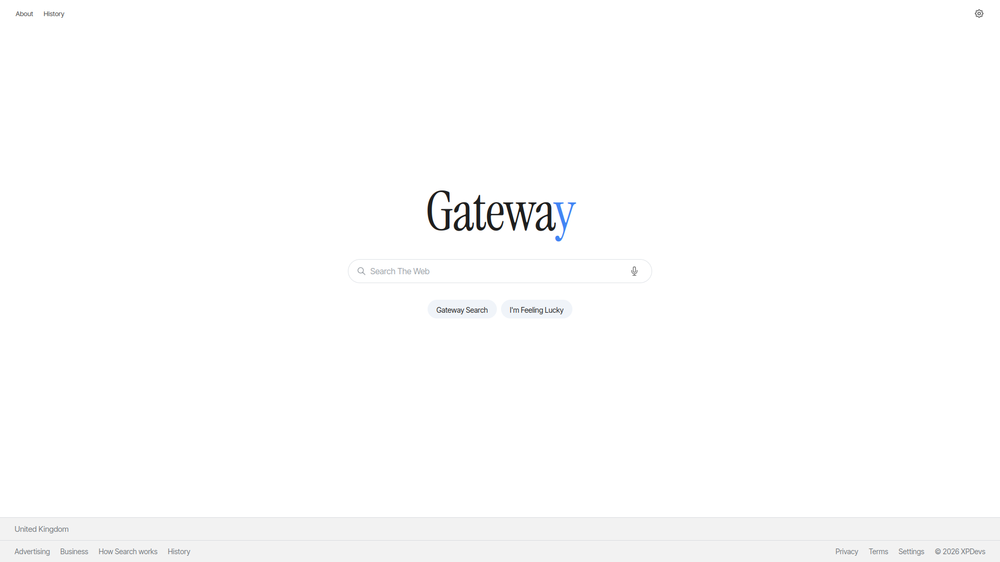

# Gateway Search

A fast, private, multi source search engine by [XPDevs](https://xpdevs.github.io). Gateway searches a bundled local web index of 50,619 real websites across 50,619 domains, plus live Wikipedia and Wikidata open data. It requires no API keys, no build step and no generative AI.



*Clean and minimal interface with instant local search.*


*Results for Costa Coffee, featuring the Quick Wiki box, result stats and favicons.*

Live behaviour. Main results paint from the local index first, typically in milliseconds. Quick Wiki, spell check and web enrichment then resolve asynchronously afterwards.

Your searches are recorded to a local only [search history](history/) you can replay, filter, switch off or delete. The history never leaves the browser and never affects ranking.

## Website owner opt-out

The bundled index is generated from Wikidata and every entry is confirmed to answer over HTTP at build time. Domain owners can opt out of being listed. No account, no form and no API key are required.

**Email `[xpdevs.github.io.com@gmail.com]`** with the subject `Index opt-out`. Include the domain to remove, for example `example.com`. List `www.example.com` separately if it resolves on its own. A link to the site, or another way to confirm ownership, speeds up the request but is not mandatory.

Opt-out requests are added to a maintained exclusion list. The domain is dropped from the bundled index the next time it is regenerated with `crawler/crawler.py`. Once removed it will not appear in the local index, in live Wikipedia or official-site enrichment, or in any custom index exported from Gateway.

The list is applied at build time, not at query time, because `index/index.json` is a static file served to every visitor. Allow until the next index refresh for the change to reach the shipped build.

## Features

**Instant main results, faster than Google for the common case**

Two stage search. Stage 1 renders `gatewaySearchLocal()` using only the local IndexedDB or memory index, with no network, inside `requestAnimationFrame`. Stage 2 enriches with `gatewayCrawl()` from live Wikipedia, official sites and cited web links without replacing the visible list.

Result stats show measured time, for example `120 ranked results (0.03 seconds)`.

`content-visibility: auto` on `.result-item`, 20 per page pagination, in memory plus `localStorage` plus IndexedDB caches, and request deduplication via `_once()` and `_inflight`.

**Quick Wiki, lazy and sourced with an image**

Deterministic answers from Wikipedia extracts and Wikidata claims such as `P577`, `P571`, `P36` and `P1082`. Date intent parsing is supported, and no generative AI is used.

Quick Wiki renders after the main list. A skeleton placeholder appears first and is replaced asynchronously when `gatewayQuickWiki()` resolves. Failures, or queries Wikipedia cannot answer, clear the skeleton and show no box at all, without touching results. Quick Wiki can be disabled entirely in Settings via `toggleQuickWiki()`, `setQuickWikiEnabled()` and `gatewayQuickWikiEnabled()`.

Summary only answers are gated on a strong title match, either exact or at least 75% subject word overlap. Weak matches return `null`.

Answer and context duplicates are eliminated. `_dedupeAnswerContext()` strips any context that repeats the answer, and a render side guard ensures the answer sentence never appears twice.

A representative image is taken from `pageimages` `thumbnail` or `original` at 500px, with a sibling article fallback. It floats right so body text wraps around it and continues underneath. The image uses `` with a caption and an `onerror` collapse that stacks full width on mobile.

The header badge reads `No generative AI`. A property chip shows the claim identifier, for example `P577`. Source links are official and cited, deduplicated per domain.

**XPDevs profile, local and deterministic**

Searching `XPDevs`, or any query containing the token such as `xpdevs`, `xp dev`, `xp-dev`, `xpdev` or `gateway search`, is answered entirely from `XPDEV_PROFILE` in `main.js` with no network call and no Wikipedia round trip.

Quick Wiki shows the profile answer, the context line, the repository count, source links for the website, GitHub, DoorsOS, ExamOS and Genesis AI, and the project logo `https://xpdevs.github.io/logo/XPDevs.png` with an `XPDevs` source badge. It never shows a false Wikipedia badge or caption.

The same query pins 62 rows above every ranked result. These are the official site, the GitHub organisation, Gateway and all 59 public repositories at `github.com/XPDevs/<name>`. Each repository row includes language, stars, last update and a `fork of an upstream project` flag where applicable. An XPDevs query renders the whole set in one page instead of 20 row pages, so no repository is hidden behind a Show more results control.

Facts are sourced from the official site at `xpdevs.github.io` covering operating systems, United Kingdom and Genesis AI focus, and from the GitHub API. Every other query path is untouched.

**Favicons on every web URL**

Each result row and each Quick Wiki source link shows a favicon. Google S2 is primary at `s2/favicons?domain=…&sz=32`, DuckDuckGo at `icons.duckduckgo.com/ip3/…` is the fallback, and a letter avatar is the final fallback, so no row lacks an icon.

Images use `loading="lazy"` and `decoding="async"`.

**Unique descriptions**

All 50,619 `index.json` descriptions are unique. Verified counts are 50,619 unique descriptions out of 50,619 and 50,619 unique URLs out of 50,619.

All 50,619 entries are real websites, one per domain, sourced from Wikidata and confirmed to answer over HTTP at build time.

**Search history, local and reversible**

Every search is recorded to `localStorage` under `gw-history` as `{q, t, n, ms}`. The fields are query, time, result count and duration. Entries are newest first and capped at 200.

Recording happens once in `performSearch()` in `main.js` after the fast local stage paints, so the stored count and duration match what the user actually saw. The Stage 2 enrichment pass corrects the count in place rather than logging a second entry.

`/history/` at `history/index.html` is a standalone static page. It cannot load `main.js`, so it implements the same reader against the same key. Entries are grouped by day, filterable, and each row replays the search via `../?query=…`. That query parameter is already honoured on load by `main.js:1108`.

Controls include delete a single search, delete all, export the list as JSON and a switch to stop recording new searches via `gw-history-optout`. Recording is on by default.

Nothing is uploaded. History is never attached to a search, never included in a custom or exported index, and never used for ranking or profiling. Storage failures such as quota limits or private mode degrade silently and never break a search.

Warning. The storage key is deliberately not named `history`. `performSearch()` uses `window.history.replaceState` from the History API, and a global of that name would clobber it. The API surface is `window.gatewaySearchHistory`.

**Index-size independent BM25F ranking**

See the Ranking section below. Field-aware BM25F over title and description, corpus-normalised IDF weights, a coordination factor, a phrase bonus and a bounded authority multiplier. Every constant is relative to the loaded corpus, so the bundled index, a custom upload of any size and live results share one score scale.

**Plus**

25 language UI, dark mode, autocomplete via `getSuggestions` with `site:` host completion, Did you mean spell check (index vocabulary first, Wikipedia second), matched-term highlighting via `gatewayHighlight`, I'm Feeling Lucky, the `site:`, `-site:`, `-word` and `"exact phrase"` operators, merge or replace custom indexes, safe domain filtering and tracking parameter stripping.

## Crawler

The bundled index was generated with the crawler in `crawler/crawler.py`, and you can run the same script to refresh it or to build your own custom index. It is a standalone, dependency free Python script that writes JSON in the same `{t, u, d, s}` shape used by the search engine. Full documentation, all flags, the terminal UI, the output schema and worked examples are in [`ccrawler.md`](crawler.md).

## Project structure

```
gateway-main/
├── index.html       # Home and results UI, settings modal
├── ui.css           # Theme, results, Quick Wiki, favicon, responsive styles
├── main.js          # UI, staged search orchestration, rendering, favicons, Quick Wiki image
├── crawl.js         # Index engine, Wikipedia and Wikidata fetchers, ranking, caches
├── index/
│   ├── index.json       # Bundled local index: [{t, u, d, s}] with 50,619 unique description entries
│   └── index-meta.json  # Index version and entry count for cache busting
├── about/ advertising/ business/ how-search-works/ history/ privacy/ terms/  # Static pages
├── favicon.ico
└── 404.html
```

## Setup

No build and no dependencies. Any static server works.

```bash
cd gateway-main
python3 -m http.server 8000
# open http://localhost:8000/
```

You can also use `npx serve .`, GitHub Pages, Nginx or any other static host. Use `http` or `https`, not `file`, because fetch and IndexedDB require it.

Custom index is optional. Go to Settings, then Upload Index, and select a JSON array of `{t, u, d, s}`. The index is validated, persisted to IndexedDB and versioned so old caches are invalidated. Settings also has an **Add to current index** toggle: off replaces the corpus (the default), on merges the upload into the corpus already loaded, with uploaded pages winning when a URL appears in both, so a topical or per-site index can sit beside the bundled one.

Settings, opened with the gear icon, include language, dark mode, Quick Wiki on or off and index upload. Quick Wiki is persisted as `gw-quickwiki` in `localStorage` and defaults to on. When Quick Wiki is off, no Quick Wiki box is fetched or rendered. The `Try "release date…"` example enables it again.

## Architecture

```
User query
  ├─ Stage 1, sync fast: gatewaySearchLocal() → prepared normalised index → score → _boostXpdevs → paint via rAF and timing
  ├─ Stage 2a, async: gatewayCrawl() → local plus Wikipedia search plus official URLs plus extlinks → merge new URLs only, sort again, update count
  ├─ Stage 2b, async and lazy: gatewayQuickWiki() → parse intent → wiki search → best page match → Wikidata claims → image → renderQuickWiki()
  └─ Stage 2c, async: gatewaySpellCheck() → renderDidYouMean()
```

Key modules.

`crawl.js` contains `_normalize`, `_prepareIndex` with term frequencies, document frequency, `avgdl` and authority, `searchIndex`, `gatewaySearchLocal`, `gatewayCrawl`, `_searchWikipedia` with opensearch to extracts, pageimages, pageprops and info, plus extlinks for the best page. It also contains `_wikidataClaims`, `_labelsForClaims`, `_formatWikidataTime`, `quickWiki` with `_dedupeAnswerContext` and `_subjectMatchRatio` gating, `getSuggestions`, `spellCheck`, `_dedupeAndRank`, `isSafeResult`, `cleanTracking`, and a tiered cache from memory to `localStorage` `gw_v7_` to IndexedDB `GatewayIndex`. It loads the bundled index from `index/index.json` and `index/index-meta.json` via `INDEX_DIR`. Query parsing lives in `_parseQuery` (`site:`, `-site:`, `-word`, quoted phrases), snippet marking in `gatewayHighlight`, offline spelling in `_oneEditNeighbours` and `_localSpellCheck`, and `site:` host completion in `_matchDomains` over the sorted domain list built with the index. Introspection helpers are `gatewayRankDebug(query)`, `gatewayAuthorityScore(domain)` and `gatewayParseQuery(query)`.

`main.js` contains `performSearch` which is staged, `_gwRender` which renders stats with seconds, `renderDidYouMean`, `renderQuickWiki` and paginated `renderItem`, `_faviconHtml` with S2, DDG and letter fallback, `_answerLinkHtml`, translations for 25 locales, dark mode and autocomplete wiring.

## Ranking

Every result, whether from the bundled index, live Wikipedia, official sites or cited web links, is scored with one hybrid function so all sources compete on identical terms.

Every quantity is defined relative to the corpus that is actually loaded, so the same constants rank a 60 page upload and the bundled 50,000 page index.

```
BM25F  ->  x coordination  ->  x phrase bonus  ->  relevance = adjusted / (adjusted + 2)
final  =  relevance x (0.78 + 0.22 x authority / 10)
```

1. Field-aware BM25F. `tf~(q,D) = Σ_f w_f · f(q,f) / (1 - b_f + b_f · |f| / avg_f)` and `BM25F(q) = Σ_q w(q) · tf~ · (k1 + 1) / (k1 + tf~)`, with `k1 = 1.2`, `w_title = 3.0`, `b_title = 0.55`, `w_description = 1.0` and `b_description = 0.75`. Title and description are separate fields, so a title hit beats the same word buried in a long description.
2. Corpus-normalised IDF. `idf(q) = ln(1 + (N - n(q) + 0.5) / (n(q) + 0.5))` and `w(q) = min(idf(q) / R, 1) ^ 1.35`, where `N` is the size of the loaded index, `n(q)` its document frequency and `R = ln(1 + 1e6)` the IDF of a reference term held by one document in a million.
   `R` is a fixed property of the weighting curve, not of any corpus, which is what makes the ranking index-size independent: a weight is a function of relative document frequency alone, stays in `[0, 1]`, and caps a document at `k1 + 1` per query term whether the index holds 5 pages or 5 million. `window.GATEWAY_RANK_CORPUS` may enlarge `N` to simulate a bigger corpus, but never shrink it below the live index, because a smaller `N` would clamp document frequencies and flatten every weight.
3. Coordination. `coverage` is the share of the query's total weight a document matched. The BM25F score is multiplied by `0.35 + 0.65 · coverage`, so a document matching one common word cannot outrank one that matches every term.
4. Phrase bonus. For multi-word queries, an exact contiguous run of the typed words gives `1.35` in the title or `1.12` in the description. The phrase keeps stopwords, so `university of oxford` matches that exact title instead of the stripped `university oxford`.
5. Bounded relevance. `relevance = adjusted / (adjusted + 2)` is a saturating map into `[0, 1)`. No term frequency, query length or index size can produce an unbounded score, so results from the index and results discovered live stay directly comparable.
6. Authority. A pre calculated static float in the range 0.0 to 10.0, PageRank style, resolved per domain. Resolution goes from an exact table to a parent domain walk such as `en.wikipedia.org` to `wikipedia.org`, then to public sector and academic host shapes such as `.gov`, `gov.uk`, `gob.ve`, `.edu` and `ac.uk`, and finally to a deterministic 2.0 to 6.0 hash band for everything else. It never varies with the query. An index entry may ship its own value in `a`, which always wins.
   Authority enters as the multiplier `0.78 + 0.22 · authority / 10`. It moves a result by at most 22 percent, which is enough to reorder close matches and break ties and never enough to overturn a clearly better one. That is the 80/20 relevance to authority intent without the scale dependence of an additive bonus, which used to swing from negligible to dominant as the index size changed.

Tokenisation. Query terms are stopword filtered. Single digits are kept, as in `PlayStation 5` and `World War 2`, while lone letters are dropped. Document text keeps every token, so stopwords still count toward the field frequencies and lengths. Matching is whole token, not substring.

Only the documents a query term occurs in are scored. `_prepareIndex` builds a postings map from term to document indexes as well as document frequency, average lengths and per field length norms, so a rich per document formula stays cheap.

Query operators. `site:example.com` keeps only that host and its subdomains, `site:example.com/news` also restricts to a path prefix, a pasted URL such as `site:https://www.example.com` is accepted, and several `site:` operators are ORed. `-site:example.com` removes a host and `-word` removes documents containing a word, both matched on whole tokens so `-car` does not remove `carpet`. A quoted `"exact phrase"` keeps its words as normal query terms but also requires them to appear adjacent and in order. Operators are removed before tokenisation, so none of them becomes a query word, and they apply to the local index and to live sources alike. They are parsed by `_parseQuery`, with `_parseSiteFilters` kept as a compatibility name, and exposed through `window.gatewayParseQuery`.

History. The original hand tuned constants are gone, including exact title `+700`, title prefix `+380`, the per field `+55`, `+32`, `+24` and `+9`, the fixed Wikipedia, official and web boosts of `2000`, `1800`, `930`, `280`, `360` and `260`, and the first BM25 hybrid that weighted IDF against a fixed 20 billion document corpus.

Verified in Node against the bundled index in this repository (50,654 entries, 80,550 terms, description average length 10.80, title average length 2.10). Warm search median is 2.27 ms with a p95 of 8.97 ms across 160 timed `gatewaySearchLocal()` calls covering plain, quoted phrase and exclusion queries; loading and parsing the index takes about 90 ms and one time preparation about 1.6 seconds, both cached in memory.

Index-size behaviour was checked on synthetic corpora of 1, 2, 5, 10, 100, 1,000, 10,000 and 50,000 documents, plus a 150,000 page run. A term kept at a constant share of each corpus converges from weight 0.148 at 100 documents (where the 0.5 smoothing dominates) to 0.227 at 50,000, the result ordering is identical at every size, and no score is ever NaN or outside `[0, 1)`. A term present in every document correctly receives weight 0 instead of dominating. On 150,000 pages a normal query takes about 6 ms and a worst case query matching almost every page stays bounded at 147 ms, because only the best `MAX_INDEX_RESULTS` candidates are ever shaped into results.

## Performance notes

First paint never awaits network, and network failures cannot blank results.

`MAX_INDEX_RESULTS=120`, `MAX_RESULTS=100` and `PER_PAGE=20`. Each search walks only the documents its query terms actually match, through a postings map built at index load, and a top-K buffer keeps the working set at `MAX_INDEX_RESULTS` however many documents match. Warm median is about 2 ms over the bundled 50,654 entry index, plus a one time precompute of postings, document frequency, field lengths and authority that takes about 1.6 seconds and is cached in memory. Preparation hands the main thread back every 2,048 documents, so the page and its spinner stay responsive while a large index is prepared instead of freezing for the whole scan.

To verify, search anything and read `result-stats`, for example `(0.04 seconds)`. Compare against Google's typical 0.3 to 0.6 second SERP time.

## Data notes

`index/index.json` format uses `t` for title, `u` for URL with tracking parameters stripped, `d` for unique description, `s` for normalised domain, and an optional `a` for pre calculated authority from 0.0 to 10.0. When `a` is absent, the domain table is used.

Regeneration check.

```bash
python3 -c "import json; d=json.load(open('index/index.json')); print(len(d), len(set(x['d'] for x in d)))"
```

This prints `50000 50000`.

Local keys written by the browser, all removable via site data. Preferences are `gw-lang`, `gw-dark` and `gw-quickwiki`. The search cache is `gw_v7_` with a 10 minute lifetime and a maximum of 30 keys. Search history uses `gw-history` and `gw-history-optout` with a maximum of 200 entries. Nothing else is persisted, and none of it is ever transmitted.

## Security and privacy

Dangerous domains, private IP hostnames, non HTTP or HTTPS URLs, and malware keyword hits are filtered by `isSafeDomain`, `isSafeResult` and `_safeHref`.

Tracking parameters such as `utm_*`, `fbclid` and `gclid` are stripped, along with URL hashes. There is no third party analytics. Favicon and image loads are the only external requests besides the Wikipedia and Wikidata APIs.

## License

This project is licensed under the XPDevs Source License (XPSL) v1.2. See [LICENSE.md](LICENSE.md) for full terms.
